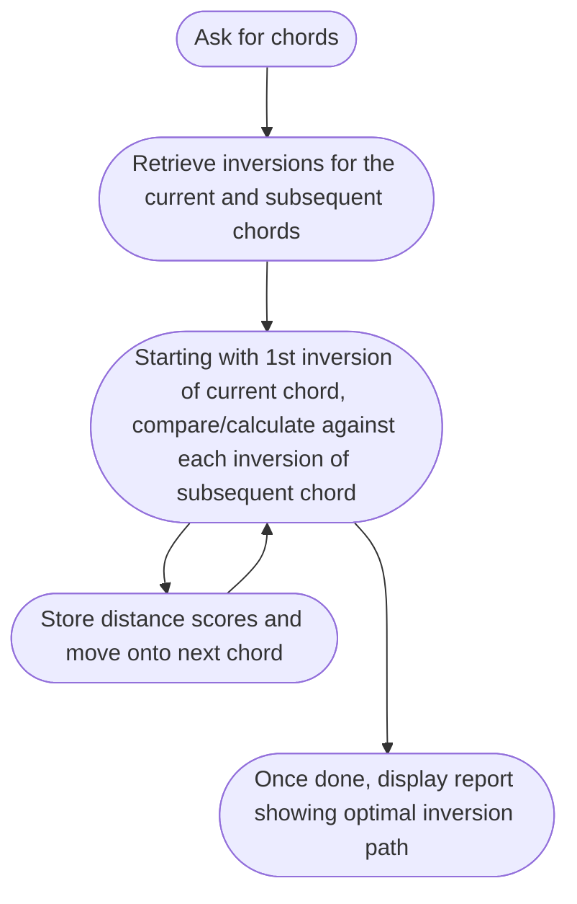

# Chord Fingering Calculator

## Purpose
Help determine what inversions a given chord progression should be played with to minimize/optimize distance between chords.

## Example

### Given:


### Output:

| Chord | Note 1 | Note 2 | Note 3 | Note 4 | Inversion |
| :--- | :--- | :--- | :--- | :--- | :--- |
| **CbM7** | Eb | Gb | A | Cb | 1st |
| **Ab-6** | Eb | ***F*** | ***Ab*** | B | 2nd |
| **Bb-7** | ***Db*** | F | Ab | ***Bb*** | 1st |
| **Eb-7** | Db | ***Eb*** | ***Gb*** | Bb | 3rd |
| **Ab-7** | ***Eb*** | ***Gb*** | ***Ab*** | ***B*** | 2nd |
| **Db7** | ***Db*** | ***F*** | Ab | B | Root |
| **GbM7** | ***E*** | ***Gb*** | ***Bb*** | ***Db*** | 3rd |
* Italicized notes are those whose finger position changed from previous chord/inversion

## Proof of Concept Definition

Given: 4 Major Triads provided by user input\
Then: Display the optimal inversions of those triads

## Possible Data Structure
* Chords as unique objects in JSON, list all of them
```json
{
	"AM7": ["A", "C#", "E", "G#"],
	"BM7": ["B", "D#", "F#", "A#"],
	"...": "..."
}
```
* Scales as objects, then do math depending on type
```json
{
	"Scale": [
		"C": ["C","D","E","F","G","A","B"],
		"D": ["D","E","F#","G","A","B","C#"],
		"...": "..."
	],
	"Type": [
		"Major": [0,1,1,0.5,1,1,0.5],
		"Minor": [0,0.5,1,1,0,5,1,1],
		"...": "..."
	]
}
```
* Notes as steps/half-steps relative to each other, do math each time. Would also have to store formulas for scale types
```json
notes.json
{
	"A": 1, # Other way around? "1": "C"
	"Bb": 1.5,
	"B": 2,
	"...": "..."
}
scales.json
{
	"Major": [0,1,1,0.5,1,1,0.5], # Maybe relative to start, so [0,1,2,2.5,3.5,4.5,5]
	"Minor": [0,0.5,1,1,0,5,1,1],
	"...": "..."
}
chords.json
{
	"Triad": [1,3,5],
	"7": [1,3,5,7],
	"...": "..."
}
Use combination of all of these to assemble chords: "Given note A of Major scale-type produce the Triad" = A, C#, E
```

## Flow of Logic


## Stretch Goals

- UI:
-- Musical Staff
-- Clickable Piano
-- Chord Library instead of Typing
- Sound
- Exclusion/Inclusion of Parameters:
-- Rootless option
-- Force chords to be certain inversions
- Show near chords (those whose score is very close to the best and might be more optimal) and provide option to choose those, prompting re-calculating of the rest of the chords
